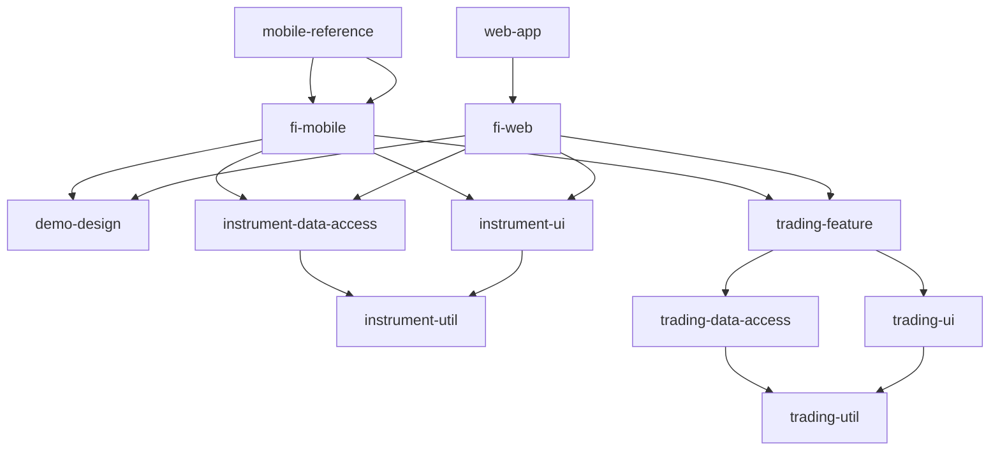

# A3 — actual Nx project graph

Generated with `npx nx graph --file=/tmp/a3-modal-graph.json`; external npm nodes omitted.

The same graph is enforced by `eslint.config.cjs`. Instrument and trading domains cannot import each other; only experience wrappers assemble them. UI cannot import state, data-access can depend on util, util has no Angular/Ionic dependency, and libraries cannot import applications. The boundary target exercises ten expected import rejections.
