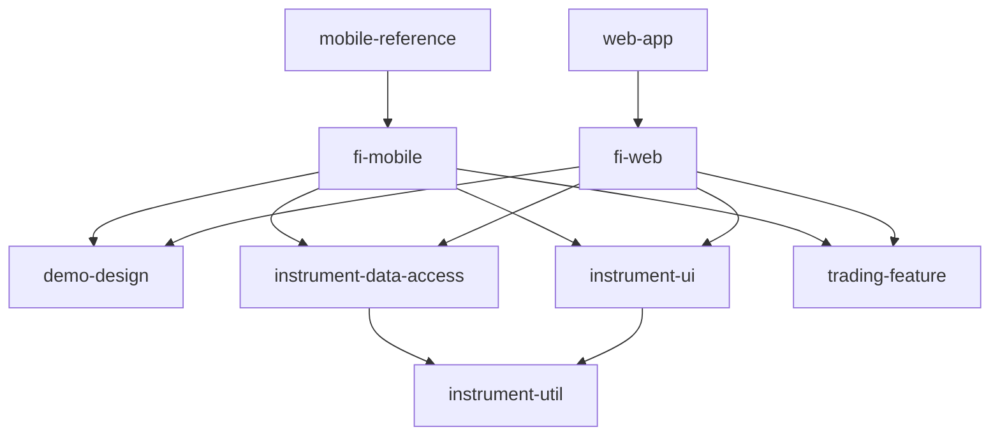

# A3 — actual Nx project graph

Generated with `npx nx graph --file=/tmp/a3-graph.json`; external npm nodes omitted.

The same graph is enforced by `eslint.config.cjs`. `domain:instrument` cannot import `domain:trading`; only `domain:composition` assembles them. UI cannot import state, and libraries cannot import applications.
